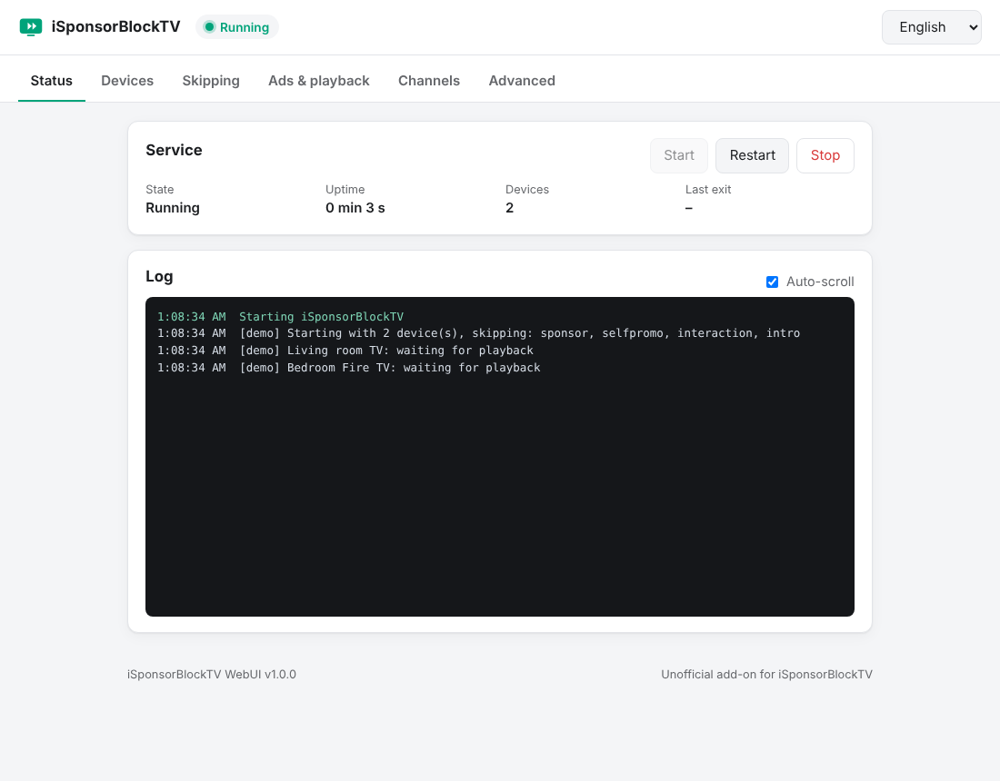
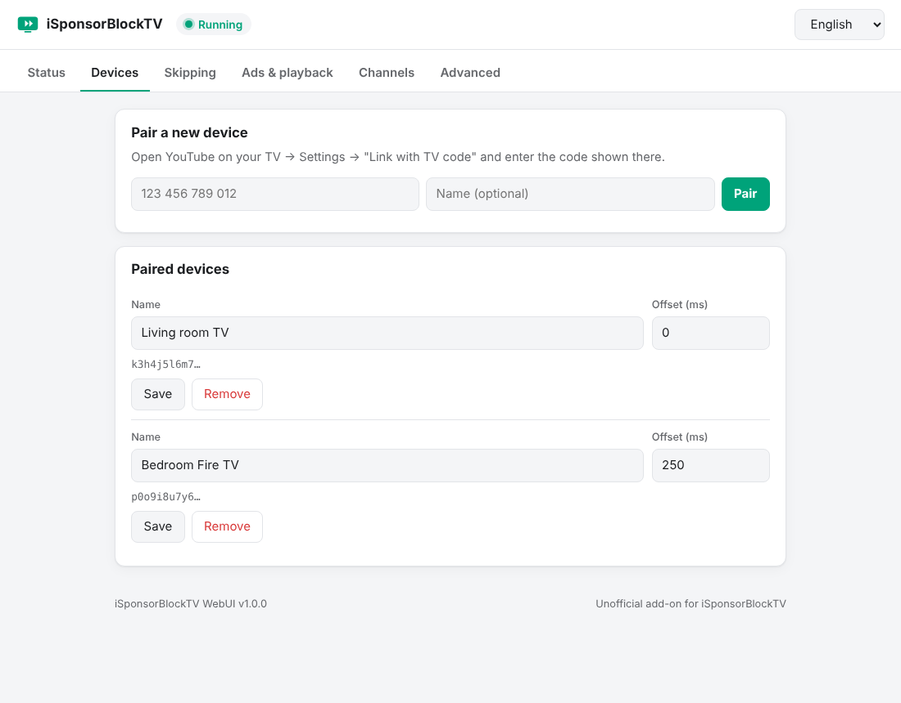
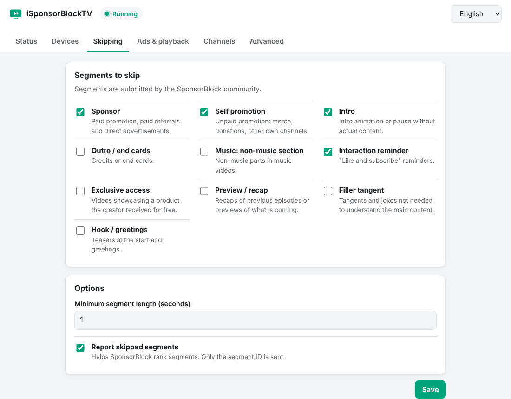
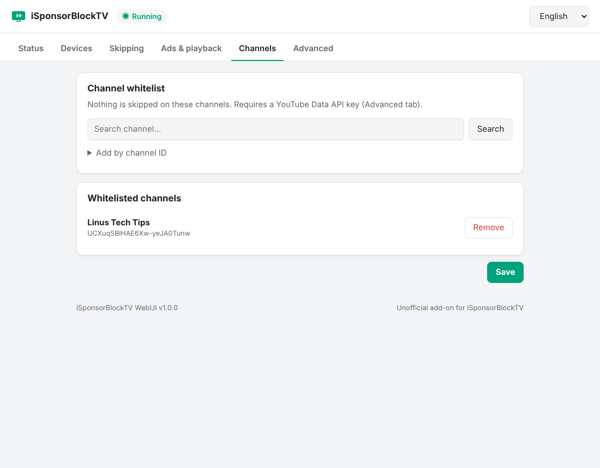

# iSponsorBlockTV WebUI

[English](README.md) · **Deutsch**

Mehrsprachige Weboberfläche für [iSponsorBlockTV](https://github.com/dmunozv04/iSponsorBlockTV).
iSponsorBlockTV überspringt SponsorBlock-Abschnitte und YouTube-Werbung auf Fernsehern und anderen YouTube-TV-Clients.

Die Oberfläche umfasst das Koppeln von Geräten, die Auswahl der zu überspringenden Abschnitte, die Kanal-Whitelist
und das Protokoll. Sie ersetzt den Einrichtungsassistenten im Terminal für die laufende Konfiguration.

> **Inoffizielle Erweiterung.** Dieses Projekt steht in keiner Verbindung zu iSponsorBlockTV oder SponsorBlock.
> Es baut auf dem offiziellen iSponsorBlockTV-Image auf und nutzt dessen Code zum Koppeln und für die Kanalsuche.



| Geräte | Überspringen | Kanal-Whitelist |
|---|---|---|
|  |  |  |

## Funktionen

- **Status und Live-Protokoll** – Prozesszustand, Laufzeit, Starten / Stoppen / Neustarten
- **Geräte** – Koppeln per *Mit TV-Code verknüpfen*, Name, Versatz, Entfernen
- **Überspringen** – SponsorBlock-Kategorien, Mindestlänge, Melden übersprungener Abschnitte
- **Werbung und Wiedergabe** – YouTube-Werbung stummschalten oder überspringen, Autoplay
- **Kanal-Whitelist** – Kanalsuche (YouTube-Data-API-Key erforderlich) oder Eingabe der Kanal-ID
- **Sprachen** – Englisch und Deutsch, Auswahl nach Browsersprache; weitere Sprachen sind eine JSON-Datei
- **Helles und dunkles Design**, responsives Layout
- **Kein Docker-Socket, kein Zugriff auf den Host**

## Aufbau

Das Image besteht aus dem offiziellen Image `ghcr.io/dmunozv04/isponsorblocktv` und einem kleinen Webserver
(Python und aiohttp, beides in iSponsorBlockTV bereits enthalten).

- Der Webserver ist der Hauptprozess des Containers und startet iSponsorBlockTV als Unterprozess.
- Beim Speichern einer Einstellung wird `config.json` geschrieben und der Unterprozess im Container neu gestartet.
- Beendet sich iSponsorBlockTV unerwartet, folgt ein automatischer Neustart mit wachsender Pause (5 s bis 5 min).
- Solange die Konfiguration unvollständig ist (z. B. kein gekoppeltes Gerät), wird iSponsorBlockTV nicht gestartet.
- Einträge in `config.json`, die die Oberfläche nicht kennt, bleiben erhalten.
- Docker-Socket und Host-Zugriff werden nicht benötigt.

```
┌──────────────────────── Container ────────────────────────┐
│  webui/server.py  (Port 8080)                              │
│     ├─ liefert Weboberfläche und JSON-API aus              │
│     ├─ liest / schreibt /app/data/config.json              │
│     └─ startet, stoppt, startet neu ──► iSponsorBlockTV    │
└────────────────────────────────────────────────────────────┘
```

## Installation

Der Container ersetzt einen vorhandenen iSponsorBlockTV-Container und verwendet denselben Datenordner.
Eine vorhandene `config.json` wird unverändert übernommen.

```yaml
services:
  isponsorblocktv:
    image: ghcr.io/kev98710/isponsorblocktv-webui:latest
    container_name: isponsorblocktv
    restart: unless-stopped
    environment:
      TZ: Europe/Berlin
      # WEBUI_PASSWORD: "aendern"
    volumes:
      - ./data:/app/data
    ports:
      - "8080:8080"
```

Das Image wird unter `ghcr.io/kev98710/isponsorblocktv-webui` veröffentlicht. Für einen lokalen Build wird `image:` durch `build: .` ersetzt.

Die Oberfläche ist unter `http://<host>:8080` erreichbar.

### Umgebungsvariablen

| Variable | Standard | Beschreibung |
|---|---|---|
| `WEBUI_PASSWORD` | *(leer)* | Aktiviert die Anmeldung. Ohne Passwort kann jeder, der den Port erreicht, die Konfiguration ändern. |
| `WEBUI_PORT` | `8080` | Port der Weboberfläche |
| `WEBUI_HOST` | `0.0.0.0` | Adresse, auf der gelauscht wird |
| `WEBUI_SESSION_HOURS` | `12` | Gültigkeit einer Anmeldung in Stunden |
| `WEBUI_LOG_LINES` | `500` | Anzahl der Protokollzeilen im Speicher |
| `ISBTV_ARGS` | *(leer)* | Zusätzliche Argumente für iSponsorBlockTV, z. B. `--debug` |

### Dateien im Datenordner

| Datei | Inhalt |
|---|---|
| `config.json` | Konfiguration von iSponsorBlockTV (gemeinsam genutzt) |
| `config.json.bak` | Vorherige Fassung, wird vor jeder Änderung geschrieben |
| `.webui_secret` | Zufallsschlüssel zum Signieren der Anmeldesitzungen |

## Sicherheit

- Ohne `WEBUI_PASSWORD` gibt es **keine Authentifizierung**. Der Port sollte dann nur aus einem vertrauenswürdigen
  Netz oder über einen Reverse Proxy mit Zugriffsschutz erreichbar sein.
- Mit Passwort sind Sitzungen signierte Cookies (`HttpOnly`, `SameSite=Strict`, `Secure` hinter HTTPS).
  Abmelden macht die Sitzung ungültig; ein geändertes Passwort macht alle Sitzungen ungültig.
- Anmeldeversuche werden nacheinander verarbeitet; Fehlversuche werden verzögert und mit Client-Adresse protokolliert.
- Ändernde Anfragen erfordern einen eigenen Request-Header, Cross-Site-Anfragen werden dadurch abgewiesen.
- Der YouTube-API-Key liegt wie bei iSponsorBlockTV in `config.json` und wird nie an den Browser zurückgegeben.
  Neue Dateien werden mit Modus `0600` angelegt; eine vorhandene `config.json` behält ihren Modus.
- Die API gibt nur bekannte Einstellungen aus. Weitere Inhalte der `config.json` werden nicht offengelegt.
- Antworten tragen eine strikte Content Security Policy; das Frontend nutzt weder Inline-Skripte noch `innerHTML`.
- Der Container läuft mit demselben Benutzer wie das offizielle iSponsorBlockTV-Image (root). Ein anderer Benutzer
  kann in Compose mit `user:` gesetzt werden, sofern er Schreibrechte auf den Datenordner hat.

Sicherheitslücken melden: siehe [SECURITY.md](SECURITY.md).

## Aktualisierung

```bash
docker compose pull && docker compose up -d
```

Das Image wird wöchentlich auf Basis des aktuellen iSponsorBlockTV-Images und bei jeder Änderung an diesem Repository neu gebaut.
Das Basis-Image wird pro Build auf einen Digest festgelegt, getestetes und veröffentlichtes Image sind daher identisch.
Schlägt der automatische Test fehl, wird nichts veröffentlicht. Der Test prüft:

- ob die für Koppeln und Kanalsuche genutzten Funktionen von iSponsorBlockTV vorhanden sind,
- ob die Weboberfläche startet und antwortet,
- ob Anfragen ohne eigenen Header und ohne Anmeldung abgewiesen werden.

Image-Tags:

| Tag | Bedeutung |
|---|---|
| `latest` | Neuester Build des Hauptzweigs |
| `isbtv-<version>` | Gebaut auf iSponsorBlockTV `<version>`, z. B. `isbtv-2.11.0` (nur wenn die Version ermittelt werden kann) |
| `<JJJJ-MM-TT>` | Build-Datum |
| `<x.y.z>`, `<x.y>` | Releases dieses Projekts |

Für ein Rollback wird ein älteres Tag verwendet. Watchtower und vergleichbare Werkzeuge funktionieren wie gewohnt.

## Weitere Sprache hinzufügen

1. `webui/static/i18n/en.json` kopieren, z. B. nach `fr.json`, und die Werte übersetzen.
2. Die Sprache oben in `webui/static/app.js` bei `LANGUAGES` eintragen.

## Entwicklung

```bash
docker build -t isponsorblocktv-webui .
docker run --rm -p 8080:8080 -v "$PWD/data:/app/data" isponsorblocktv-webui
```

- Frontend: HTML, CSS und JavaScript in `webui/static`, ohne Build-Schritt
- Backend: `webui/server.py`
- Basis-Image: Build-Argument `ISBTV_IMAGE` (Standard `ghcr.io/dmunozv04/isponsorblocktv:latest`)

## Lizenz

GPL-3.0, wie iSponsorBlockTV. Siehe [LICENSE](LICENSE).
