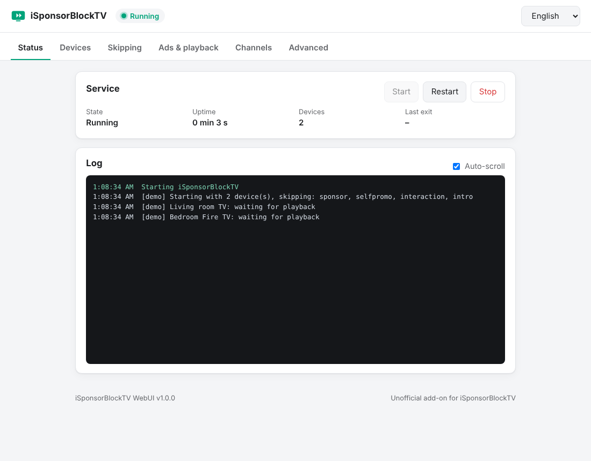
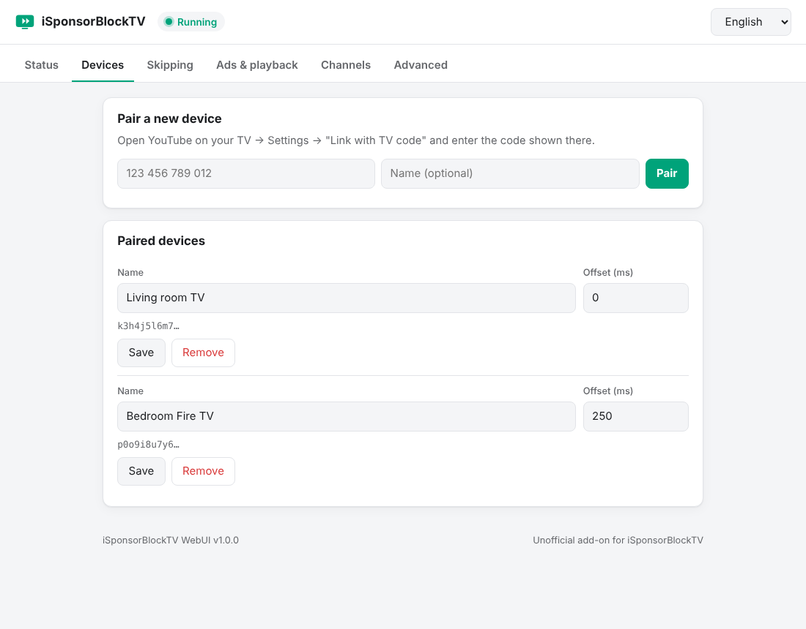
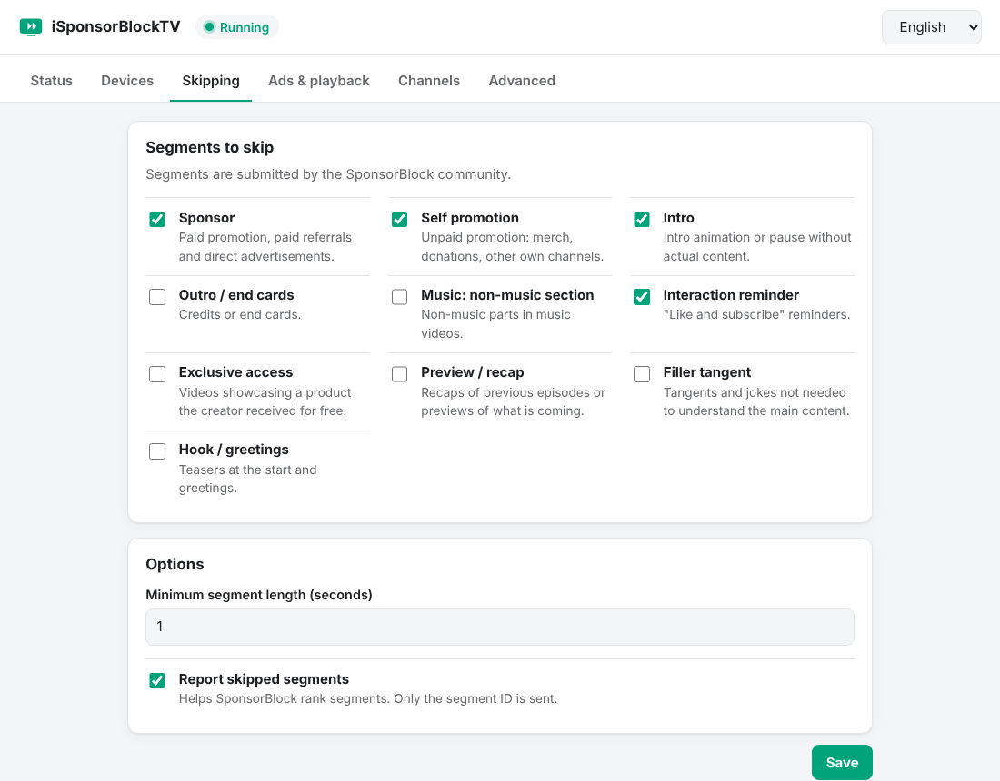
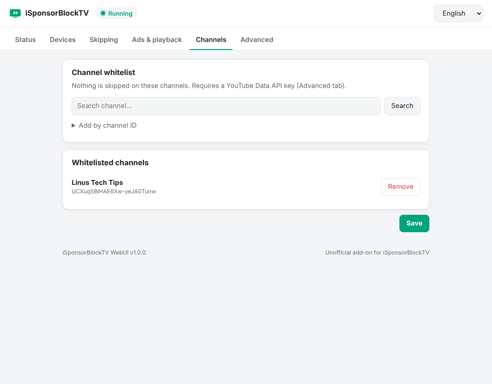

# iSponsorBlockTV WebUI

**English** · [Deutsch](README.de.md)

Multilingual web interface for [iSponsorBlockTV](https://github.com/dmunozv04/iSponsorBlockTV),
which skips SponsorBlock segments and YouTube ads on TVs and other YouTube TV clients.

The interface covers pairing devices, selecting the segments to skip, managing the channel whitelist
and viewing the log. It replaces the terminal setup wizard for day-to-day configuration.

> **Unofficial add-on.** This project is not affiliated with iSponsorBlockTV or SponsorBlock.
> It is built on top of the official iSponsorBlockTV image and uses its code for pairing and channel search.



| Devices | Skipping | Channel whitelist |
|---|---|---|
|  |  |  |

## Features

- **Status and live log** – process state, uptime, start / stop / restart
- **Devices** – pairing with a *Link with TV code*, name, offset, removal
- **Skipping** – SponsorBlock categories, minimum segment length, segment reporting
- **Ads and playback** – mute or skip native YouTube ads, autoplay
- **Channel whitelist** – channel search (requires a YouTube Data API key) or manual entry by channel ID
- **Languages** – English and German, selected from the browser language; additional languages are a single JSON file
- **Light and dark theme**, responsive layout
- **No Docker socket, no host access**

## Architecture

The image consists of the official `ghcr.io/dmunozv04/isponsorblocktv` image and a small web server
(Python and aiohttp, both already included in iSponsorBlockTV).

- The web server is the main process of the container and starts iSponsorBlockTV as a child process.
- Saving a setting writes `config.json` and restarts the child process inside the container.
- An unexpected exit of iSponsorBlockTV triggers an automatic restart with increasing delay (5 s up to 5 min).
- iSponsorBlockTV is not started while the configuration is incomplete (for example, no paired device).
- Keys in `config.json` that the interface does not know are preserved.
- The Docker socket and host access are not required.

```
┌──────────────────────── container ────────────────────────┐
│  webui/server.py  (port 8080)                              │
│     ├─ serves the web interface and JSON API               │
│     ├─ reads / writes /app/data/config.json                │
│     └─ starts, stops and restarts ──► iSponsorBlockTV      │
└────────────────────────────────────────────────────────────┘
```

## Installation

The container replaces an existing iSponsorBlockTV container and uses the same data directory.
An existing `config.json` is used as is.

```yaml
services:
  isponsorblocktv:
    image: ghcr.io/kev98710/isponsorblocktv-webui:latest
    container_name: isponsorblocktv
    restart: unless-stopped
    environment:
      TZ: Etc/UTC
      # WEBUI_PASSWORD: "change-me"
    volumes:
      - ./data:/app/data
    ports:
      - "8080:8080"
```

The image is published at `ghcr.io/kev98710/isponsorblocktv-webui`. To build locally, replace `image:` with `build: .`.

The interface is available at `http://<host>:8080`.

### Environment variables

| Variable | Default | Description |
|---|---|---|
| `WEBUI_PASSWORD` | *(empty)* | Enables the login. Without a password, anyone who can reach the port can change the configuration. |
| `WEBUI_PORT` | `8080` | Port of the web interface |
| `WEBUI_HOST` | `0.0.0.0` | Listen address |
| `WEBUI_SESSION_HOURS` | `12` | Lifetime of a login session |
| `WEBUI_LOG_LINES` | `500` | Number of log lines kept in memory |
| `ISBTV_ARGS` | *(empty)* | Additional arguments for iSponsorBlockTV, for example `--debug` |

### Files in the data directory

| File | Content |
|---|---|
| `config.json` | iSponsorBlockTV configuration (shared with iSponsorBlockTV) |
| `config.json.bak` | Previous version, written before every change |
| `.webui_secret` | Random key used to sign login sessions |

## Security

- Without `WEBUI_PASSWORD` there is **no authentication**. In that case the port should only be reachable
  from a trusted network or through a reverse proxy with access control.
- With a password, sessions are signed cookies (`HttpOnly`, `SameSite=Strict`, `Secure` behind HTTPS).
  Logging out invalidates the session; changing the password invalidates all sessions.
- Login attempts are processed one at a time; failed attempts are delayed and logged with the client address.
- Requests that change data require a custom request header, so cross-site requests are rejected.
- The YouTube API key is stored in `config.json`, as in iSponsorBlockTV, and is never returned to the browser.
  New files are created with mode `0600`; an existing `config.json` keeps its mode.
- The API returns only known settings. Other content of `config.json` is not exposed.
- Responses carry a strict Content Security Policy; the frontend does not use inline scripts or `innerHTML`.
- The container runs as the same user as the official iSponsorBlockTV image (root). A different user can be
  set with `user:` in Compose if the data directory is writable for it.

Security issues: see [SECURITY.md](SECURITY.md).

## Updates

```bash
docker compose pull && docker compose up -d
```

The image is rebuilt weekly on top of the current iSponsorBlockTV image and on every change to this repository.
The base image is pinned to a digest per build, so the tested and the published image are identical.
Publishing is blocked if the smoke test fails. The test checks that:

- the iSponsorBlockTV functions used for pairing and channel search exist,
- the web interface starts and answers,
- requests without the custom header and without login are rejected.

Image tags:

| Tag | Meaning |
|---|---|
| `latest` | Latest build of the main branch |
| `isbtv-<version>` | Built on iSponsorBlockTV `<version>`, e.g. `isbtv-2.11.0` (only set if the version can be determined) |
| `<YYYY-MM-DD>` | Build date |
| `<x.y.z>`, `<x.y>` | Releases of this project |

A previous tag can be used for a rollback. Watchtower and similar tools work as usual.

## Adding a language

1. Copy `webui/static/i18n/en.json`, for example to `fr.json`, and translate the values.
2. Add the language to `LANGUAGES` at the top of `webui/static/app.js`.

## Development

```bash
docker build -t isponsorblocktv-webui .
docker run --rm -p 8080:8080 -v "$PWD/data:/app/data" isponsorblocktv-webui
```

- Frontend: plain HTML, CSS and JavaScript in `webui/static`, no build step
- Backend: `webui/server.py`
- Base image: build argument `ISBTV_IMAGE` (default `ghcr.io/dmunozv04/isponsorblocktv:latest`)

## License

GPL-3.0, as iSponsorBlockTV. See [LICENSE](LICENSE).
